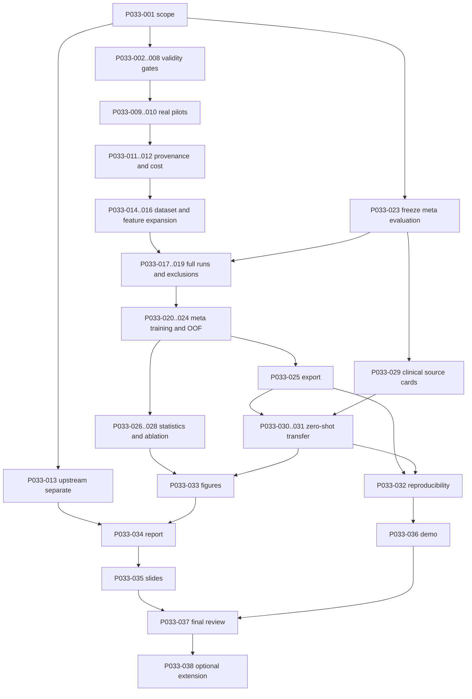

# CSCI447P033 — исполнимый backlog

[Главный план](MASTER_PLAN.md) · [Аудит](PROJECT_AUDIT.md) · [Требования](REQUIREMENTS.md) · [Методология](EXPERIMENT_PLAN.md) · [Тесты](TEST_AND_ACCEPTANCE_PLAN.md) · [Deliverables](FINAL_DELIVERABLES.md)

Baseline2026-10-30, обновление P033-002: **P033-001 и P033-002 DONE** в acceptance scope своих карточек; остальные задачи сохраняют будущий статус, P033-003 READY, P033-023 DECISION. P0=validity/blocker, P1=Tier B, P2=sensitivity, P3=optional. Роли — предложения распределения, не назначенные людям обязательства: E=engineering lead, R=research lead, V=второй студент/reviewer; Daniyar и Yerassyl выбирают роли самостоятельно. Status TODO означает нет подтверждения completion; DECISION означает нужен отдельный freeze/выбор; READY — можно начать; EXTERNAL — нужен внешний ресурс, независимые ветки продолжаются; DONE — acceptance конкретной карточки выполнен с evidence, не всех связанных requirements.

Общий DoD **каждой** задачи: выполнены перечисленные steps, output существует и проверен указанным методом, acceptance выполнен, traceability IDs и research log обновлены, нет необъяснённого изменения frozen protocol. Активное время указано отдельно от ожидания compute/access. Batch tasks — контейнеры повторяемых subtasks по1–4 h; не одна неограниченная задача. Все proposed functions/flags ниже ещё не существуют, если прямо не сказано «существует».

## 1. Next 10 Tasks: команды и проверяемый выход

Команды из корня проекта, PowerShell; ими **не запускается full benchmark**. `uv run --locked` сохраняет lock. При sandbox cache проблеме перед commands: `$env:UV_CACHE_DIR = Join-Path (Get-Location) 'artifacts/uv_cache'`. `--basetemp=artifacts/pytest_tmp` использовать только для pytest-managed temporary artifacts. Для CMD использовать `set UV_CACHE_DIR=%CD%\artifacts\uv_cache`; bash `export UV_CACHE_DIR="$PWD/artifacts/uv_cache"`. Редактирование файлов и review decisions — обязательные шаги, shell command не заменяет их.

| ID | Конкретное действие и files | Точная команда после/для работы | Проверяемый результат |
|---|---|---|---|
| P033-001 / DONE | Scope baseline, Tier B working target, D011–D020 dispositions и official unknowns записаны | `git show ea1de5a --stat`; `git show b6b88e0 --stat` | [Decision ledger](decisions.md), [unknowns](RISKS_AND_OPEN_QUESTIONS.md), acceptance checklist ниже; full evaluation freeze остаётся P033-023 |
| P033-002 / DONE | Windows/Ubuntu matrix, format/lock/timeouts/concurrency, socket-blocked suite, shell instructions и actual clean install | `uv lock --check --offline`; `uv run --locked --offline ruff check .`; `uv run --locked --offline ruff format --check .`; `uv run --locked --offline pytest -q --basetemp=artifacts/pytest_tmp` (parent `artifacts` должен существовать) | 38 tests, actual locked install, обе OS green в двух clean attempts; [evidence/commands](reproducibility.md#portable-locked-setup-p033-002) |
| P033-003 | Source/license/admission cards пяти pilots, docs/data_dictionary.md; проверить IDs/versions/terms, не менять данные ради winners | `uv run --locked p033 datasets --output artifacts/pilot_registry.json`; `git diff -- docs/data_dictionary.md configs/datasets.toml` | 5 source cards: source/version/license evidence/family/target/time/roles/unknowns |
| P033-004 | Написать tests/test_preprocessing.py на existing checked wrappers, guard/leakage/all-missing | `uv run --locked pytest -q tests/test_preprocessing.py --basetemp=artifacts/pytest_tmp` | New file создаётся этой задачей; finite dimensions, pre-allocation rejection и train-only fit доказаны fixtures |
| P033-005 | tests/test_model_families.py + tests/test_runner.py:20 candidates, seed/tie/TOML parity/full signature | `uv run --locked pytest -q tests/test_model_families.py tests/test_runner.py --basetemp=artifacts/pytest_tmp` | Deterministic20+20, paired indices, intended defaults; tests fail on deliberate config drift |
| P033-006 | Исправить admission: meta_dataset.py, build_meta_dataset.py, schemas/model_run.schema.json, tests/test_meta_dataset.py | `uv run --locked pytest -q tests/test_meta_dataset.py --basetemp=artifacts/pytest_tmp` | Fixture folder smoke+full+excluded+malformed → declared accepted set+reject report, no smoke training; spoofed full rejected |
| P033-007 | Explicit schema feature allowlist и general-only fence в meta_dataset/recommender/evaluation, tests/test_recommender.py/test_evaluation.py | `uv run --locked pytest -q tests/test_meta_dataset.py tests/test_recommender.py tests/test_evaluation.py --basetemp=artifacts/pytest_tmp` | Clinical contamination и numeric outcome injection rejected; allowed feature schema preserved |
| P033-008 | runner.py split_strategy gate, audit→admission policy, tests/test_runner.py/test_audit.py | `uv run --locked pytest -q tests/test_runner.py tests/test_audit.py --basetemp=artifacts/pytest_tmp` | Unsupported grouped/time never silently stratified; actual class coverage invalid→clear exclusion |
| P033-009 | Скачать/проверить5 pilots, результаты в artifacts/data cache и results/summaries/dataset_audits | `uv run --locked p033 fetch all --output artifacts/datasets.json`; `uv run --locked python scripts/audit_datasets.py` | Metadata matches, audits reviewed, conflicts/groups/exclusions logged до fit |
| P033-010 | Реальные small smoke5, отдельно от primary full input | `uv run --locked python scripts/collect_openml_results.py --mode smoke --output-dir results/development/smoke --summary results/development/smoke_index.json` | 5 outcomes, success или конкретный failure, research_valid=false у всех; ни одного primary meta row |

Нет команды для неизвестной official rubric: P033-001 фиксирует вопрос, работа над подтверждённой частью продолжается. Первый реальный full **после** P033-011/012 planning gates, а не автоматически после чтения документа.

## 2. Detailed Full Backlog

### P033-001 — Scope и research decisions

- **Phase / priority / status / роль:** PH0 / P0 / **DONE, 2026-10-30** / R+V (предложенные роли); **2–4 h план**, фактическая трудоёмкость не измерялась, ML compute0.
- **Зависимости / inputs:** аудит, пользовательское задание, existing protocol/D001–D010; внешняя rubric если предоставлена.
- **Steps:** 1) сопоставить title/ID/objective; 2) записать official/repo/proposed/unknown; 3) выбрать Tier и resource assumptions; 4) принять/отложить D011–D020 с impact; 5) запретить final-outcome tuning.
- **Files/functions:** docs/decisions.md, docs/RISKS_AND_OPEN_QUESTIONS.md, configs/project.toml только после naming decision; новых code functions нет.
- **Outputs / tests / acceptance:** decisions ledger; T09, V читает отсутствие invented university constraints; критерии и scope зарегистрированы.
- **Риск / DoD:** unresolved rubric не блокирует инженерные fixes; common DoD + reproducible scope baseline.

**Acceptance evidence (documentation scope, T09 static/self-review):**

- [x] ID/title/working extension name, RQ1–RQ3 и actual code scope сопоставлены в [scope baseline](decisions.md#p033-001--scope-baseline-2026-10-30), OFFICIAL / REPOSITORY DECISION / RESEARCH RECOMMENDATION / OPTIONAL / UNKNOWN разделены; university rubric/deadlines не придуманы, Q11 naming не закрыт переименованием.
- [x] Tier B выбран рабочей целью; dataset counts/effort/compute явно planning assumptions до P033-012/014/015/029, без обязательств университета или неподтверждённой feasibility.
- [x] Для всех D011–D020 записаны status, decision/rationale, source/assumptions, protocol/result compatibility, зависимости/verification timing и tasks; accepted design отделён от implemented/verified. Ledger: scope commit `ea1de5a`, research commit `b6b88e0`.
- [x] Two pipelines, target MLP−GBDT, operational margin0.01, family evaluation, general/clinical fence, separate zero-shot transfer и допустимость negative/inconclusive findings зафиксированы. Primary Ridge/LOGO baseline выбран prospectively, P033-023 остаётся DECISION до полного manifest.
- [x] Markdown links/anchors, table columns, task/decision identifiers и `git diff --check` проверены; D001–D010, frozen0.1/alias, configs/settings, implementation/dependencies неизменны. Master/risks/experiment plan/backlog и [research log](research_log.md#2026-10-30--p033-001-scope-and-research-decisions) согласованы; independent human peer review не выдаётся за выполненный.

Остаток **вне completion этой карточки**: внешние Q01/Q02/Q06/Q08/Q09/Q11, доступные active hours из Q03; будущие source-specific Q04, feature/sampler Q07, publication Q10, bootstrap/family feasibility и P033-023 manifest. Эти проверки принадлежат указанным downstream tasks, не подменены assumptions; отсутствие rubric не останавливает P033-002. Другие task statuses этим завершением не повышаются.

### P033-002 — Environment и CI portability

- **PH3 / P1 / DONE, 2026-10-30 / E; 2–4 h план**, active time не измерялось; pytest summaries в успешных CI attempts на `567320d`: 1.57–5.60 s; limit 5 min/test step, job 15 min.
- **Deps / input:** P033-001 для accepted compatibility; existing Python3.14.7/lock/35 tests.
- **Steps:** 1) сохранить baseline versions; 2) добавить Windows/Ubuntu matrix, format+lock validation и timeout; 3) убрать network dependence default suite; 4) описать Temp/cache workaround; 5) проверить clean install в новой разрешённой папке без удаления текущей .venv.
- **Files:** CI, pyproject.toml только если нужна test config, docs/reproducibility.md; functions не нужны.
- **Output / tests / AC:** T08; supported OS green, locked sync и no guessed package upgrades; CI URLs или честный pending status.
- **Risk / DoD:** unavailable interpreter/network→record blocker; не менять Python только для удобства; common DoD.

**Acceptance evidence (environment/CI scope T08, common DoD):**

- [x] Новая проверка baseline: Python 3.14.7 / uv 0.12.18 и locked package versions сохранены, 35 tests до изменений прошли; прежний аудит не выдан за новые checks. Python/pyproject/lock, configs, ML implementation и frozen0.1 не менялись.
- [x] Windows/Ubuntu matrix, explicit offline lock/Ruff/format, locked sync, timeouts/concurrency и два suite runs/job добавлены; [attempt 1](https://github.com/DenKish2005/ml-p033-model-recommender/actions/runs/41019812975/attempts/1) и [attempt 2](https://github.com/DenKish2005/ml-p033-model-recommender/actions/runs/41019812975/attempts/2) на `567320d` success на обеих OS. Каждый job — fresh checkout/env/install без restored cache. Начальный [failed run](https://github.com/DenKish2005/ml-p033-model-recommender/actions/runs/41019463627) расследован и исправлен отдельным commit.
- [x] Default suite socket-disabled: 38 passed дважды в старой и новой env; existing OpenML tests mocked, synthetic runner only. Network scenarios требуют marker + `--run-network`; opt-in probe проверен без connections/downloads. Новые tests проверяют accidental socket/connection/DNS access, не увеличивают ML coverage искусственно.
- [x] Фактическая clean install в новой `artifacts/p033002/clean-env-2`: 19 packages installed, compatibility check и повтор suite green; `.venv` сохранена. Первая DNS-blocked попытка честно записана отдельно от успешной установки; dry-run не использовался как evidence.
- [x] [Воспроизводимые команды и evidence](reproducibility.md#portable-locked-setup-p033-002): PowerShell/CMD/bash без make, workspace Temp/cache, basetemp parent, initial network/cache limits. CMD и Git Bash команды выполнены в дополнительных новых env; native Ubuntu проверена hosted CI, не выдана за локальную Linux-проверку.
- [x] Diff/staged review, whitespace, Markdown links/anchors/identifiers и сохранность scientific baseline проверены; [research log](research_log.md#2026-10-30--p033-002-environment-and-ci-portability) и master согласованы. Commits/push идут непосредственно в main; independent human acceptance не заявляется.

В P033-002 нет pending platform/clean-install checks. Real OpenML, benchmarks/upstream, дальнейшие T08 CLI/E2E cases, полный T14 и G1 остаются вне выполненного scope. P033-003 READY, но не выполнялась; P033-023 остаётся DECISION.

### P033-003 — Пять pilot source cards

- **PH0/5 / P0 / READY / R; 3–4 h**, network metadata only.
- **Deps:** 001; input registry5/source pages.
- **Steps:** original terms/citation review; snapshot metadata; verify target/positive/features; review cohorts and unavailable predictors; register family/duplicate policy; record unresolved access.
- **Files:** configs/datasets.toml, docs/data_dictionary.md; code reuse `DatasetSpec`.
- **Outputs/tests/AC:** five cards, T01/T09; every admitted source has permissions evidence, no generic Public-as-license inference.
- **Risk/DoD:** legal/metadata ambiguity→candidate pending, not silent admission; common DoD.

### P033-004 — Preprocessor edge/leakage verification

- **PH3 / P0 / READY / E; 3–4 h**, synthetic fits only.
- **Deps:** 001/002; input handmade mixed/numeric/categorical frames.
- **Steps:** add unknown/all-missing/constants/bool fixtures; spy training imputer/scaler fit; encoded-width arithmetic/boundaries; direct-transform bypass review; fixes only for failing contract, no redesign.
- **Files/functions:** tests/test_preprocessing.py new; preprocessing.py checked wrappers/validation only if required; `DensePreprocessor` reused.
- **Outputs/tests/AC:** T03; all fixtures finite, no test categories in fit, guard throws before onehot materialization.
- **Risk/DoD:** total RSS not bounded by one matrix; report copies; common DoD.

### P033-005 — Protocol and candidate parity

- **PH3 / P0 / READY / E; 3–4 h**, stubbed fitting / tiny smoke.
- **Deps:** 004; input frozen TOML/Python settings.
- **Steps:** check full/smoke constants; test20 unique candidates+baseline+seed; controlled scores test tie; spy shared split IDs; add parity check rather than loading all TOML unnecessarily.
- **Files/functions:** tests/test_model_families.py new, tests/test_runner.py; factories/BenchmarkProtocol unchanged unless defect.
- **Outputs/tests/AC:** T04; mismatch intentionally fails; 54/27 search spaces, no early stopping, candidate counts exact.
- **Risk/DoD:** no accidental protocol change while fixing drift; common DoD.

### P033-006 — Strict result admission

- **PH3/8 / P0 / READY / E; 3–4 h**, synthetic JSON only.
- **Deps:** 005; input valid/invalid/mixed result fixtures.
- **Steps:** define `validate_benchmark_result(result, expected_protocol)` PROPOSED; verify fields/finite/ranges/actual completed folds and params; `select_research_results(paths)` returns accepted+rejected manifest; separate smoke; enforce source/protocol identity and duplicate policy.
- **Files:** meta_dataset.py, scripts/build_meta_dataset.py, schemas/model_run.schema.json/meta_dataset.schema.json, tests/test_meta_dataset.py.
- **Output/tests/AC:** T05/T06; no name-only full trust; mixed workflow usable, rejected files visible, malformed JSON report explicit.
- **Risk/DoD:** strict schema migration may invalidate older artifacts; preserve originals and explain; common DoD.

### P033-007 — General-domain and predictor fence

- **PH3/9 / P0 / READY / E; 2–4 h**, offline fixtures.
- **Deps:** 006; input current feature keys/clinical flags.
- **Steps:** add versioned `feature_schema`/explicit allowlist; reject unknown score-like predictors; reject clinical rows on general training/evaluation path; permit clinical only separate transfer evaluation; tests injecting both contamination types.
- **Files/functions:** features.py/meta_dataset.py/recommender.py/evaluation.py, related tests; reuse train/evaluate functions with explicit domain policy.
- **Output/tests/AC:** T06/T07/T12; clinical train=0, outputs/provenance not selected as features.
- **Risk/DoD:** backwards-compatible v1 schema, no unexplained dropping columns; common DoD.

### P033-008 — Split/duplicate admission gates

- **PH3 / P0 / READY / E+R; 3–4 h**, synthetic only.
- **Deps:** 003/004/005; input split_strategy, audit counters.
- **Steps:** reject unsupported strategies early; validate both classes in actual train/validation/test; persist duplicate review decision; test rare classes/too-small test; no silent dedup or K reduction.
- **Files/functions:** runner.py (`validate_split` PROPOSED), audit.py/scripts, tests/test_runner.py/test_audit.py.
- **Output/tests/AC:** T04/T09; impossible distributions clear failure, grouped/time request never stratified fallback.
- **Risk/DoD:** protected grouped general variant requires new protocol; common DoD.

### P033-009 — Real pilot fetch/audit

- **PH4 / P0 / TODO / E+R; 2–4 h active**, network/cache small public pilots; no models.
- **Deps:** 003/008; input5 registered sources.
- **Steps:** fetch all; retain metadata/local checksum; audit; compare expected roles/missingness/labels; manually resolve duplicate/signature decisions before benchmarking.
- **Files:** use datasets.py/audit.py without rewrite; outputs artifacts/datasets.json, results/summaries/dataset_audits/*.json.
- **Tests/AC:** T01/T02/T08;5 matched validations or explicit source blocker; no failed sources hidden.
- **Risk/DoD:** OpenML timeout/drift→source card update and documented exclusion, not substitute ID; common DoD.

### P033-010 — Five real smoke runs

- **PH4 / P0 / TODO / E; 1–3 h active**,50 estimator fits maximum planned, wall time measured.
- **Deps:** 006/007/008/009; input validated pilots.
- **Steps:** credit-g first; inspect trial/warnings/scores; remaining4 sequentially; review JSON; verify development namespace and research_valid=false; record failure tickets.
- **Files/functions:** reuse collect_openml_results/run_benchmark; results/development/smoke/*.json + smoke_index.json.
- **Tests/AC:** T08; all5 success for engineering gate or unresolved blockers enumerated; no claim of research validation.
- **Risk/DoD:** adult slow→stop scheduling after recorded timeout, no full; common DoD.

### P033-011 — Provenance, atomic writes and recovery

- **PH3/7 / P0 / TODO / E; 6–10 h** split into11a manifest2–3h,11b atomic save2–3h,11c resume/tests2–4h; cheap failure simulations.
- **Deps:** 006/010; input run schema and observed smoke failure modes.
- **Steps:** `collect_run_metadata` PROPOSED (git/env/OS/CPU/RAM/threads/checksums/config/candidates/splits); `write_result_atomic`; compatible identity-aware resume per outer unit; save index incrementally; preserve failed attempts; fix custom summary dirs/batch exit semantics.
- **Files:** runner.py, collect_openml_results.py, schemas/model_run.schema.json, tests/test_runner.py and tests/test_cli.py new.
- **Outputs/tests/AC:** results/manifests/*, T05/T08; interrupted write not admitted, unrelated config never overwritten/skipped, complete valid logs.
- **Risk/DoD:** resume mixing code versions; explicit immutable identity; common DoD.

### P033-012 — First full and cost calibration

- **PH4/7 / P0 / TODO / E; 2–4 h active**,366 estimator fits one small pilot; unknown wall/RSS until measured.
- **Deps:** 011/005/008; input credit-g full0.1, resources known.
- **Steps:** record host budget; run exact full CLI once; verify360+6 completeness; read timing/peakRSS; estimate remaining n×encoded_width bands and scheduling cap; retain scientific failure if any.
- **Files/command:** existing runner; `uv run --locked p033 benchmark credit-g --mode full --output results/raw_model_runs/credit-g.full.json` (будущий expensive command).
- **Outputs/tests/AC:** T04/T05/T10; canonical validator accepts or explicit exclusion; resource_budget.csv measured/proposed columns distinguished.
- **Risk/DoD:** one dataset timing not universal; use bands/ranges; common DoD.

### P033-013 — Upstream isolated partial reproduction

- **PH1/2 / P1 / EXTERNAL / R; 8–16 h**:13a paper/source card2–4h,13b isolated setup2–4h,13c bounded attempt2–4h,13d comparison2–4h; compute separately bounded, no full study.
- **Deps:** 001/002; inputs paper v3, pinned commit, Linux3.11.7, permitted MBGM files if accessible.
- **Steps:** read article/source; inspect requirements/model helpers; create separate clone/env; disable submission in logged local config/adapter and prevent helper default run; verify no-submit path handles metrics; audit MBGM; one local CatBoost/default/minimalistic attempt; capture true errors; classify reproduced/partial/blocked.
- **Files/functions:** scripts/run_reproduction.py safe command/config/version/timeout metadata, docs/upstream_reproduction.md new, docs/related_work.md new, docs/reproducibility.md; external clone not vendor code.
- **Outputs/tests/AC:** T14, results/checkpoint1/*; no remote submission, exact environment and limitations. Missing Kaggle access/GPU→documented blocker; does not stop general branch.
- **Risk/DoD:** no-token/no-data fallback is source/env audit, explicitly not numerical reproduction; common DoD.

### P033-014 — Systematic general dataset discovery

- **PH5 / P1 / TODO / R; 4–8 h**, split metadata search2–4h + cohort review2–4h; no huge downloads.
- **Deps:** 003/012; input shortlist experiment plan, measured budget.
- **Steps:** verify candidate metadata/source mappings; exclude clinical/duplicates/unsupported tasks prospectively; plot coverage from metadata; extend candidates until target independent families plausible; log rejected sources before scores.
- **Files:** docs/data_dictionary.md, configs/datasets/openml_general.toml; no unnecessary discovery framework.
- **Outputs/tests/AC:** candidate/admission ledger, T09;20–30 target not achieved by source variants; licence unknown marked pending.
- **Risk/DoD:** insufficient candidates→reduce claim breadth/Tier, not biased winner selection; common DoD.

### P033-015 — Register and validate expansion batches

- **PH5 / P1 / TODO / E+R; 8–16 h** in batches3–5 sources, each2–4h; downloads chosen sizes only.
- **Deps:** 014/009; input verified candidate cards.
- **Steps:** pin IDs/version/checksum/roles/labels/family; validate source fixtures; fetch/audit; class/split/memory preflight; update inventory/exclusion ledger.
- **Files/functions:** configs/datasets.toml, tests/test_datasets.py, datasets.py only necessary validation extensions.
- **Outputs/tests/AC:** T01/T09; admitted registry20–30 or documented feasible smaller scope, never claim achieved count before fetch.
- **Risk/DoD:** correlated sources reduce effective n; publish family count; common DoD.

### P033-016 — Versioned compact and extended meta-features

- **PH6 / P1 / TODO / E+R; 8–12 h**,16a definitions/schema2h,16b cheap stats2–4h,16c correlation sampling2h,16d validation/timing2–4h.
- **Deps:** 007/014; input experiment-plan formulas/raw training fixtures.
- **Steps:** implement numeric/categorical/correlation helpers in features.py; preserve v1; compute v2 NA/defined-count indicators; deterministic sample caps; expected fixture arithmetic; extraction cost check; freeze primary compact schema before production labels inspection.
- **Files:** features.py, tests/test_features.py, docs/data_dictionary.md; existing code reuse.
- **Outputs/tests/AC:** T02/T10; formula/edge table passes, no model outcomes, timings documented; `feature_schema` allows only agreed predictors.
- **Risk/DoD:** too many predictors small n→compact primary; fullv2 ablation; common DoD.

### P033-017 — Full pilot completion

- **PH7 / P1 / TODO / E; 2–4 h active**,total5 pilots1830 fits including compatible P012 credit-g, not1830 extra automatically.
- **Deps:** 012/016; inputs pilot source/split/protocol manifests.
- **Steps:** reuse validated identical runs; backfill descriptors from same split IDs if safe; full remaining sources; validator/index; record exclusions/resources.
- **Files/command:** `uv run --locked python scripts/collect_openml_results.py ionosphere spambase adult tic-tac-toe --mode full`; scripts resume must not overwrite incompatible run.
- **Outputs/tests/AC:**5 audited full outcomes, T05; primary only successful paired; excluded reason retained.
- **Risk/DoD:** large MLP time/convergence, all-or-nothing bias; common DoD.

### P033-018 — Expanded full production batches

- **PH7 / P1 / TODO / E; 4–8 h active**,batches management1–2h each;20–30 total datasets7320–10980 fits including pilots, resource estimate via P012.
- **Deps:** 015/016/017/023; input frozen admitted set, feature/selection protocols, budget.
- **Steps:** smoke new sources first; schedule compatible full by cost bands; persist checkpoints; compare attempted vs expected counts; stop new jobs at budget limit without shortening trials; no outcome-based removals.
- **Files:** existing scripts/configs; results/raw_model_runs/, manifests/index/resources.
- **Tests/AC:** T05/T10; all admitted sources attempted or budget/access reason, no silent missing runs.
- **Risk/DoD:** weeks elapsed possible, no invented wall-time promise; common DoD.

### P033-019 — Failure reconciliation and exclusion analysis

- **PH7/13 / P0 / TODO / E+R; 3–6 h**,review3h + repair/rerun decision up to3h; reruns count separately.
- **Deps:** 018; input complete attempt logs and descriptors, including excluded.
- **Steps:** classify scientific/protocol vs infra failures; rerun only identical corrected infra cases with attempt lineage; keep initial failure; quantify exclusion by n,p,cardinality/domain; assess selection bias.
- **Files:** audit/collect scripts if needed; results/summaries/exclusions.csv, research_log.
- **Tests/AC:** T05/T09/T10; no unexplained failures or success-only cohort narrative.
- **Risk/DoD:** changing search budget creates new experiment, not repair; common DoD.

### P033-020 — Build primary meta-dataset

- **PH8 / P0 / TODO / E; 2–4 h**,CSV/JSON cheap.
- **Deps:** 006/007/016/019; input compatible full manifests.
- **Steps:** strict admission; source/cohort dedup; mean aggregation; allowlist; general-only table; manifest/exclusion report; frozen train/eval snapshot.
- **Files/functions:** meta_dataset.py builder reused; `uv run --locked python scripts/build_meta_dataset.py` после006; accepted selection contract must be documented.
- **Outputs/tests/AC:** T06, results/meta_dataset.csv+manifest; exact1 row per independent selected dataset, gap recomputed and checked.
- **Risk/DoD:** n insufficient→exploratory Tier A, no fabricated rows; common DoD.

### P033-021 — Meta preprocessing

- **PH9 / P1 / TODO / E; 2–4 h**,small meta fits.
- **Deps:** 020/007; input schema v1/v2 + NA policies.
- **Steps:** `make_meta_preprocessor` PROPOSED: median+indicators, scaling for Ridge only; all-missing column rule deterministic; fit within meta-train; schema validation before transform.
- **Files:** recommender.py/evaluation.py; tests/test_recommender.py.
- **Outputs/tests/AC:** T07; held-out extreme values do not affect training statistics; no silent incompatible feature order.
- **Risk/DoD:** meta-missingness itself correlated with model gap; transparent indicators; common DoD.

### P033-022 — Baselines and four recommenders

- **PH9 / P1 / TODO / E+R; 2–4 h**,meta-model fits inexpensive vs base benchmark.
- **Deps:** 021/023; input primary meta table and preregistration.
- **Steps:** preserve existing Dummy/Ridge/tree/RF; add explicit constant strategies and best-fixed-from-training; test margin; compare default outputs without tuning final outcomes; record model configs.
- **Files/functions:** recommender.py existing factories, tests/test_recommender.py/evaluation.py.
- **Outputs/tests/AC:** T07; all required baselines present, main Ridge fixed before scoring; no in-sample claim.
- **Risk/DoD:** one winner class→honest trivial baseline strength; common DoD.

### P033-023 — Freeze meta evaluation and optional nested selection

- **PH0/10 / P0 / DECISION / R+V; 2–4 h**,before018; optional nested implementation additional3–4h explicitly Tier B sensitivity.
- **Deps:** 001/014; input candidate family identities, not final performance.
- **Steps:** LOGO primary; assign any lockbox groups; fix Ridge and primary paired regret metric; predefine sensitivity/secondary comparisons; if tuning enabled implement grouped inner splits/default for tiny n; record immutable manifest timestamp/hash.
- **Baseline из P033-001 (не completion P033-023):** [D013/D014](decisions.md#d013--prespecified-primary-meta-model) уже выбирают fixed scaled Ridgeα1, family LOGO, equal-dataset paired regret vs best fixed только на meta-train; D012 clinical fence обязателен, D015/D016/D018 ещё proposed. На candidate source/family identities P033-014 уточнить grouping/eligible folds/rows, primary feature/sampling/NA contract, stability/multiplicity и secondary policy. Nested tuning только optional secondary, lockbox feasibility/allocation deferred; redesign после OOF — untouched evaluation или exploratory label. Всё это внести в prospective timestamp/hash manifest до P033-018/final results, без выбора main model по outcomes. Manifest и проверки пока не выполнены.
- **Files:** configs/experiments/recommender.toml, docs/decisions.md, evaluation.py only for nested option.
- **Outputs/tests/AC:** T07/T09; no source/family overlap and no final data-driven main-model selection.
- **Risk/DoD:** small n for nested CV→fixed primary, not random row split; common DoD.

### P033-024 — Full held-out metrics and CLI artifacts

- **PH10 / P1 / TODO / E; 3–4 h**,LOGO4 models≈4×families fits (RF300 trees internal, not base-fit count).
- **Deps:** 022/023; input meta table.
- **Steps:** `evaluate_recommender` add MAE/balanced winner accuracy/near-ties, explicit invalid selected label; verify manual regret fixture; OOF predictions exactly once; separate per-model output dirs and summary mkdir; record all baseline losses.
- **Files:** evaluation.py, scripts/evaluate_recommender.py, tests/test_evaluation.py/test_cli.py.
- **Outputs/tests/AC:** T07; results/summaries/recommender/<model>/predictions.csv/summary.json, no overwrites; fixed primary metric correct.
- **Risk/DoD:** LOFO apparent success noisy; CI next; common DoD.

### P033-025 — Export and true unseen-dataset inference

- **PH9/14 / P1 / TODO / E; 4–8 h**,25a serialization2–4h,25b CLI/matching extraction2–4h; cheap inference.
- **Deps:** 024/016; input selected frozen config/general table.
- **Steps:** fit general-only final model; `save_recommender/load_recommender` PROPOSED with trusted local artifacts and version/schema hashes; `characterize_for_recommendation` same75% sampling contract; `p033 recommend` PROPOSED labelled CSV→gap/pipeline/fallback JSON; OOD/range check and finite validation.
- **Files:** recommender.py/features.py/cli.py/scripts/train_recommender.py; tests/test_inference.py new.
- **Outputs/tests/AC:** T11; artifacts/recommender/model.pkl+manifest.json, roundtrip identical, no benchmark fit/outcomes needed.
- **Risk/DoD:** untrusted pickle refused by policy, artifact compatibility explicit; fallback best fixed selected from general training; common DoD.

### P033-026 — Statistical uncertainty

- **PH13 / P1 / TODO / R+E; 3–4 h**,B2000 cluster resamples of saved OOF table cheap.
- **Deps:** 024/023; input fixed paired per-dataset losses.
- **Steps:** `bootstrap_regret_difference` PROPOSED with family clusters/seed; report percentile95% CI; repeated-seed variability descriptive; specify conditional nature; secondary multiplicity policy.
- **Files:** evaluation.py, tests/test_statistics.py new; outputs results/summaries/uncertainty.json.
- **Tests/AC:** T10; family integrity, reproducible endpoints, constant-difference fixture; no treating outer splits as independent n.
- **Risk/DoD:** few families wide CI, no forced superiority claim; common DoD.

### P033-027 — Feature interpretation and ablation

- **PH11 / P1 / TODO / R+E; 6–10 h**,27a groups3h,27b stability3h,27c interpretation0–4h; multiple meta CV fits, no new base fits if features reconstructed safely.
- **Deps:** 016/024/026; input raw training descriptor versions/OOF assignments.
- **Steps:** coefficient stability; fold-safe permutation where feasible; v1/compact/full and group-drop ablations; repeat grouped evaluation with fixed settings; annotate correlations/uncertainty.
- **Files:** evaluation.py/reporting.py and notebook05 optional, tests/test_statistics.py.
- **Outputs/tests/AC:** T10/T13; ablations.csv, importance.csv, no causal labels, same families across comparisons.
- **Risk/DoD:** low n/high p→unstable importance reported, not cherry-picked; common DoD.

### P033-028 — Error, sensitivity and negative-result analysis

- **PH11/13 / P1 / TODO / R; 3–6 h**,threshold sweep cheap; grouped sensitivity fits separately counted.
- **Deps:** 026/027; input predictions/exclusions/source cards.
- **Steps:** .0/.005/.01/.02 margins; worst-regret cases; domain/family/synthetic sensitivity; compare admitted/excluded; review OOD and missingness; write evidence-supported RQ drafts including failures.
- **Files:** evaluation.py/reporting.py, docs/research_log.md; results/summaries/error_analysis.csv.
- **Tests/AC:** T10/T13; primary.01 unchanged, no hindsight replacement datasets/models.
- **Risk/DoD:** exploratory hypotheses labelled, no causal story from examples; common DoD.

### P033-029 — Clinical source admission

- **PH12 / P0 / TODO / R+V; 4–8 h**,2–4 source cards2–4h each in batches; small metadata/downloads only.
- **Deps:** 003/023; input official UCI shortlist, clinical policy.
- **Steps:** permissions/attribution, prediction time/endpoint, patient/time availability, ID/post-outcome exclusions, class/missingness audit; choose3–5 feasible independent cohorts for Tier B, or2–3 Tier A; avoid WDBC as pristine holdout due demo exposure.
- **Files:** configs/datasets/clinical.toml, clinical.py adapter, docs/clinical_data_policy.md/data_dictionary.md; loader schema evolution must preserve general registry.
- **Outputs/tests/AC:** T09/T12; clinical inventory/split plan no labels used to choose meta-model.
- **Risk/DoD:** follow-up time/leaky diagnostic endpoint; redefine task prospectively or reject; common DoD.

### P033-030 — Clinical loaders and grouped/temporal engine

- **PH12 / P0 / TODO / E+R; 8–14 h**,30a adapter2–4h,30b splitter3–4h,30c integration3–6h split by strategy; synthetic tests first.
- **Deps:** 029/008/025; input patient/time/source roles and frozen model.
- **Steps:** clinical adapter→LoadedDataset-compatible contract with group/time outside predictors; `make_clinical_splits` PROPOSED handles registered grouped/forward split; group both inner/outer; validate class coverage and temporal ordering; versionD017; never invent timestamp from follow-up duration.
- **Files:** clinical.py, datasets.py/runner.py explicit split injection, tests/test_clinical.py; configs clinical protocol.
- **Outputs/tests/AC:** T12; patient intersections empty, future not in train, no raw identifiers in result outputs, unchanged general0.1 tests.
- **Risk/DoD:** grouped feasible folds may differ3×3; separate manifest/fit ledger; common DoD.

### P033-031 — Zero-shot clinical evaluation

- **PH12 / P1 / TODO / E+R; 3–6 h active**,3–5 small compatible clinical datasets≈1098–1830 fits **только если**3×20×3 applicable; otherwise actual registered count.
- **Deps:** 025/030; input frozen general model + clinical development data.
- **Steps:** save predictions before benchmark labels; model checksum unchanged; run registered paired clinical benchmark; compute regret/fixed baselines; group-level uncertainty appropriate to tiny n; summarize shift.
- **Files/functions:** scripts/run_clinical_evaluation.py replace placeholder, clinical.py/evaluation.py; results/summaries/clinical_transfer/.
- **Tests/AC:** T12;0 clinical rows in meta-training, no recalibration, per-cohort outcomes/limitations retained even failures.
- **Risk/DoD:** no clinical gain is valid finding; no treatment/deployment claims; common DoD.

### P033-032 — Reproducibility and artifact packaging

- **PH14 / P1 / TODO / E+V; 4–8 h**,32a storage/security2–4h,32b independent clean clone2–4h; smoke only by default.
- **Deps:** 011/024/025/031 (можно начать storage ранее).
- **Steps:** ignore raw datasets/token/model blobs/external clones; explicit tracked summary allowlist; archive manifests; clean clone locked setup; offline tests+one public smoke; regenerate saved-result metrics; capture exact commands and checksums; update README/ARCHITECTURE/NEXT_STEPS/data dictionary.
- **Files:** .gitignore, CI/docs/reproducibility.md/README.md, scripts if command discrepancies.
- **Outputs/tests/AC:** T08/T09/T14; independent reader succeeds or bounded blocker documented; no tokens/patient rows/raw medical uploads.
- **Risk/DoD:** raw restriction not workarounded by commit; document acquisition; common DoD.

### P033-033 — Figures and scientific tables

- **PH14 / P1 / TODO / E+R; 6–10 h**,33a tables2h,33b plots2–4h,33c QA2–4h; saved artifacts only.
- **Deps:** 026/027/028/031; input validated results and CIs.
- **Steps:** implement `load_validated_summaries`, `make_benchmark_table`, `make_recommender_table`, `make_figures` PROPOSED in existing reporting.py; choose/pin minimal plotting dependency if needed; no estimator fitting; axes/units/counts/uncertainty provenance; inspect exported figures.
- **Files:** reporting.py, scripts/make_figures.py, tests/test_reporting.py new; results/figures/*.svg/png + summaries.
- **Tests/AC:** T13; seven required plot types, numeric table equality, no dummy values/no orphan source.
- **Risk/DoD:** seaborn/matplotlib не установлены сейчас; dependency addition separate lock/version record; common DoD.

### P033-034 — Academic report

- **PH15 / P1 / TODO / R+V; 12–20 h**,разделы по2–4h; compute0.
- **Deps:** 013/028/031/033; inputs tables, protocols, negative findings.
- **Steps:** написать21 раздел по final deliverables; every claim→artifact/citation; scope/leakage/power limitations; reconcile abstract/title/figures; technical and language review; export preferred format only after rubric confirmed.
- **Files:** docs/final_report.md + docs/references.bib new; docs/final_report.pdf после formatting/export choice.
- **Tests/AC:** T09/T13; RQ1–3 answered evidence or limited/unknown, no fabricated results.
- **Risk/DoD:** unspecified page count/style→UNKNOWN, not blocker draft; common DoD.

### P033-035 — Presentation

- **PH15 / P1 / TODO / R+E; 4–8 h**,35a narrative2–4h,35b visual/rehearsal2–4h; compute0.
- **Deps:** 034; input verified figures and report.
- **Steps:** build12 slides from final deliverables outline; annotate sample/family counts; separate reproduction vs original contribution; rehearse within later confirmed time; check readable plots.
- **Files:** presentation/outline.md, presentation/CSCI447P033_slides.pptx and PDF new **на этой фазе**, не сейчас.
- **Tests/AC:** T09 visual QA; slide claims match report; no invented university timing.
- **Risk/DoD:** template missing→neutral academic layout; common DoD.

### P033-036 — Offline technical demo

- **PH15 / P1 / TODO / E+V; 2–4 h**,inference seconds target measured, public smoke optional.
- **Deps:** 025/032/033; input sanitized unseen general fixture + saved validated artifacts.
- **Steps:** demonstrate registry/audit→features→saved model→gap/choice/fallback→OOF/regret figure; disclose labelled sample and scope; prepared offline caches; no full HPO live.
- **Files:** docs/demo_script.md, data acquisition instructions; fixture synthetic/sanitized permitted; inference JSON.
- **Tests/AC:** T11/T14; clean demo works without network; smoke clearly labelled if shown.
- **Risk/DoD:** cache absent→use synthetic engineering demo, not pretend research score; common DoD.

### P033-037 — Final submission review

- **PH15 / P0 / TODO / V+E+R; 3–6 h**,37a evidence checklist2–3h,37b independent review1–3h.
- **Deps:** 032/034/035/036 plus official rubric if available.
- **Steps:** populate70 requirement evidence statuses; verify paths/links/commands; check Git status/artifact allowlist; source licenses/privacy; report-slide consistency; required university package checklist; tag/export proposal only under authorized workflow, no auto push.
- **Files:** docs/submission_checklist.md new, planning status updates only with evidence.
- **Outputs/tests/AC:** T09/T14; no P0 unresolved, final output manifest complete, negative result accepted; missing official requirements explicitly flagged.
- **Risk/DoD:** no real rubric→research package ready but cannot certify unspecified institutional compliance; common DoD.

### P033-038 — Optional broader families/preprocessing

- **PH7/11 Tier C / P3 / DECISION / E+R; +60–140 h**,adapters/tests/model selection/compute pilots in2–4h units; GPU budget additional.
- **Deps:** Tier B complete/P033-037; input separate preregistered expanded protocol.
- **Steps:** add ≥2 distinct estimators per family (e.g. HistGBDT+CatBoost/XGBoost; MLP+ResNet/FT-Transformer/MLP-PLR), pin dependencies/env; per-model pilot; family selection **inside inner loop**; cost-balanced secondary design; preprocessing regimes separate experiments; no post-outer-score best-of-family.
- **Files:** model_families.py or minimal adapter module if needed, configs/models/new files only when implemented, runner.py/tests/protocol v2.
- **Outputs/tests/AC:** T04/T09; family claim explicitly limited to registered portfolio; compute ledger3×K×20×3+3K=183K estimator fits/dataset before extra regimes; K4→732 vs366.
- **Risk/DoD:** model count/HPO/feature treatment confounding; strong claims require robustness not merely adding package names; common DoD.

## 3. Dependency graph и critical path

Внутри ranges зависимости определены карточками, а не подразумевают все-to-all. Например023 freeze выполняется до018 и до просмотра final meta results;029 source metadata review можно делать заранее,031 — только после frozen general artifact. Upstream branch внешне независима: невозможность Kaggle/GPU не останавливает general experiments, но final report обязан описать actual reproduction scope.

Critical path по зависимостям:001→004/005/006/007/008→009/010→011/012→014/015/016→017/018/019→020/021/022/024→025→030/031→033/034→035/037. Вторая сходящаяся ветка024→026/027/028→033. Самое большое неизвестное elapsed time — expanded full runs, не написание кода. Поиск rubric и upstream access могут идти параллельно как организационные работы; этот план не поручает агентам автоматически делегировать работу.

## 4. Effort ledger и milestone review

Активная работа Tier B ориентировочно **160–260 h** с учётом reuse, review и доработок; optional nested HPO/повторные source reviews могут увеличить оценку. Для budget резервировать **190–310 h** при environment/access failures. Не складывать repeated pilot fits, labels reuse и new runs дважды. Tier A сокращает расширение/features/ablations, но не P0 validity, baselines и clinical fence. Tier C добавляет60–140h и model compute; сильная полноценная reproduction может добавить больше и оценивается отдельно.

Milestones: M0 scope+gates (P033-001 DONE, source cards/P033-023 ещё открыты; весь M0 не DONE); M1 real smoke5; M2 first valid full+cost; M3 independent dataset corpus+complete benchmarks; M4 primary OOF baseline comparison; M5 zero-shot clinical+uncertainty; M6 reproducible report/slides/demo. При gate failure исправить конкретный defect, обновить assumptions/estimates и продолжить; не объявлять DONE по названию файла. P033-002 DONE в environment/CI scope; следующая P033-003 READY, её source admission этим этапом не выполнялся.
